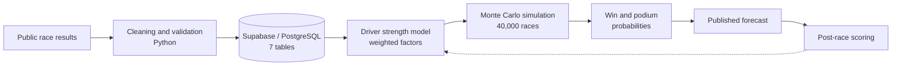

# Formula 1 Race Predictor 2026

[](https://f1-predictions-q4.vercel.app)
[](https://f1-predictions-q4.vercel.app/#versions)
[](https://f1-predictions-q4.vercel.app/data/)
[](https://vercel.com)

A probabilistic forecasting model for the final five races of the 2026 Formula 1 season. Each forecast is published before the race and scored publicly afterwards, with every hit and miss recorded.

**Live application:** https://f1-predictions-q4.vercel.app

---

## Overview

| Component | Description | Link |
|---|---|---|
| Race predictor | Current forecast (v3, Las Vegas Grand Prix) with adjustable model weights, season scorecard and a pre-registered experiment | [Open](https://f1-predictions-q4.vercel.app) |
| Fantasy dashboard | Three-level analytics dashboard: executive overview → driver diagnosis → race-level records with CSV export | [Open](https://f1-predictions-q4.vercel.app/dashboard/) |
| Data dictionary | Schema, column definitions and data quality checks for all seven tables | [Open](https://f1-predictions-q4.vercel.app/data/) |
| Archived versions | v2 (São Paulo) and v1 (Mexico City), preserved exactly as published | [v2](https://f1-predictions-q4.vercel.app/sao-paulo/) · [v1](https://f1-predictions-q4.vercel.app/mexico/) |

## Forecast performance

| Race | Model | Favourite | Winner | Probability assigned to winner | Winner's rank | Podium picks |
|---|:-:|---|---|:-:|:-:|:-:|
| Mexico City | v1 | Antonelli (28%) | Verstappen | 13% | 2nd | 2 / 3 |
| São Paulo (wet) | v2 | Antonelli (43%) | Norris | 28% | 2nd | 1 / 3 |
| Las Vegas | v3 | Verstappen (55%) | Verstappen | 55% | 1st | 2 / 3 |
| Qatar | – | – | – | – | – | – |
| Abu Dhabi | – | – | – | – | – | – |

The model is judged on calibration as well as winners: events forecast at 30% should occur roughly 30% of the time. The full scorecard is on the live site.

### Benchmark against the market (from Las Vegas)

Forecasts are compared with Polymarket's winner market, recorded before the start and scaled to remove its margin (raw prices summed to 115.5%).

| Las Vegas | Probability assigned to winner | Log score | Podium picks |
|---|:-:|:-:|:-:|
| **v3 (official)** | **55%** | **−0.60** | **2 / 3** |
| v3 + practice pace (experiment) | 49% | −0.71 | 2 / 3 |
| Polymarket (scaled) | 47% | −0.76 | 1 / 3 |

Everyone missed Piastri, who finished 3rd from 17th on the grid. One race is not a meaningful sample, so the comparison continues for the remaining races.

## Methodology



**1. Data.** The dataset covers every 2026 result: 440 race results, sprints, starting grids, track history and wet-race team-mate comparisons. Points are reconciled against the official championship standings, including post-race penalties. It's stored as seven normalized tables with primary and foreign keys, row-level security and documented column definitions.

**2. Driver strength.** Each driver gets a weighted score from five factors:

| Factor | Default weight | Definition |
|---|:-:|---|
| Season performance | 35 | Points per start across the season |
| Car pace | 35 | Average finishing value of the team's cars over the last 8 rounds |
| Recent form | 15 | Last six races, most recent weighted highest |
| Qualifying | 10 | Q3 appearances per start |
| Track history | 5 | Results at the circuit over the last three years |

On top of this, retirement risk (own record blended with the field average) and wet-weather skill (team-mate comparisons in wet races) adjust each driver's score.

**3. Simulation.** Strengths are converted into finishing orders with a Plackett–Luce model using Gumbel noise. 40,000 races are simulated and blended by the forecast probability of rain. Once qualifying is complete, a logarithmic starting-grid effect is applied.

**4. Validation.** Design choices are selected by leave-one-race-out testing on races with published starting grids.

| Grid-effect specification (9 races) | Avg. probability given to winner | Podium log score | Favourite won |
|---|:-:|:-:|:-:|
| v2 (hand-set grid penalty) | 29% | −5.68 | 5 / 9 |
| **v3 (logarithmic curve)** | **34%** | **−5.36** | 5 / 9 |

## Version history

| Version | Race | Changes |
|---|---|---|
| v1 | Mexico City | Full-season dataset, five weighted factors, retirement risk, Monte Carlo simulation |
| v2 | São Paulo | Rain probability, wet-weather skill, circuit history, official starting grid |
| v3 | Las Vegas | Starting grids for 12 races; grid effect and noise level calibrated by out-of-sample testing; live weather inputs |

### Ongoing experiment: does practice pace improve forecasts?

Starting with Las Vegas, a second forecast adds the FP2 classification at a fixed weight of 25. The method was pre-registered on 18 November 2026, before any practice session. The official forecast remains v3. Both versions are scored after each race, and the results are reported whatever the outcome.

## Tech stack

| Layer | Tools |
|---|---|
| Data preparation | Python |
| Database | Supabase (PostgreSQL), row-level security, SQL views |
| Model and interface | JavaScript, HTML, CSS (no framework) |
| Hosting | Vercel, deployed from GitHub |

## Repository structure

```
.
├── index.html        Current predictor (v3, Las Vegas)
├── dashboard/        Fantasy Pit Wall dashboard
├── data/             Seven CSV tables and data dictionary
├── sao-paulo/        v2, archived as published
└── mexico/           v1, archived as published
```

---

Personal project by Maya Gerlach. The data comes from publicly available race results. Not affiliated with Formula 1, the FIA or any team. All illustrations are original.
